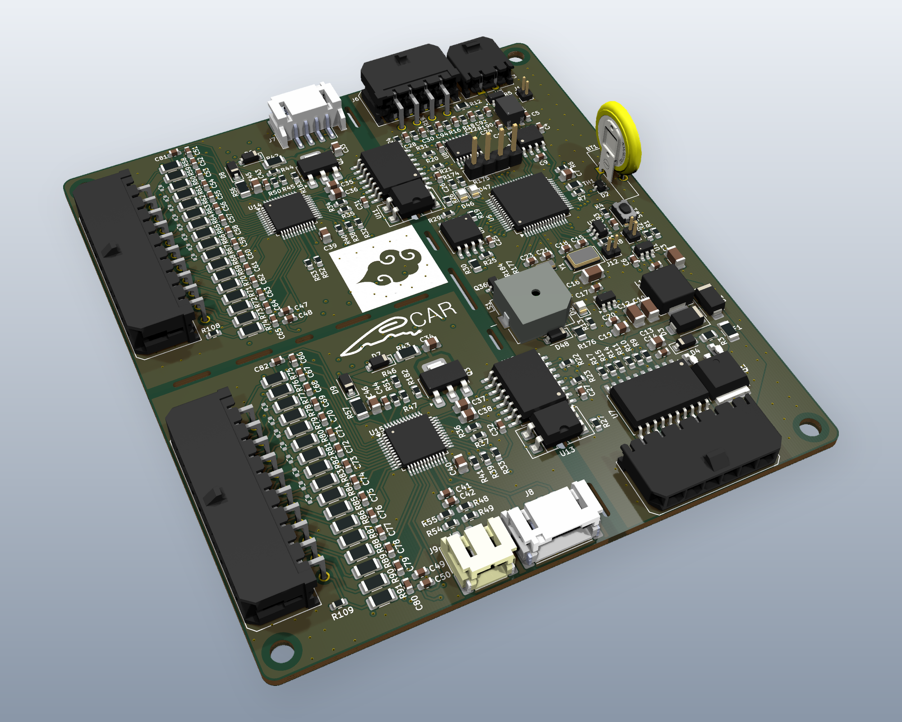
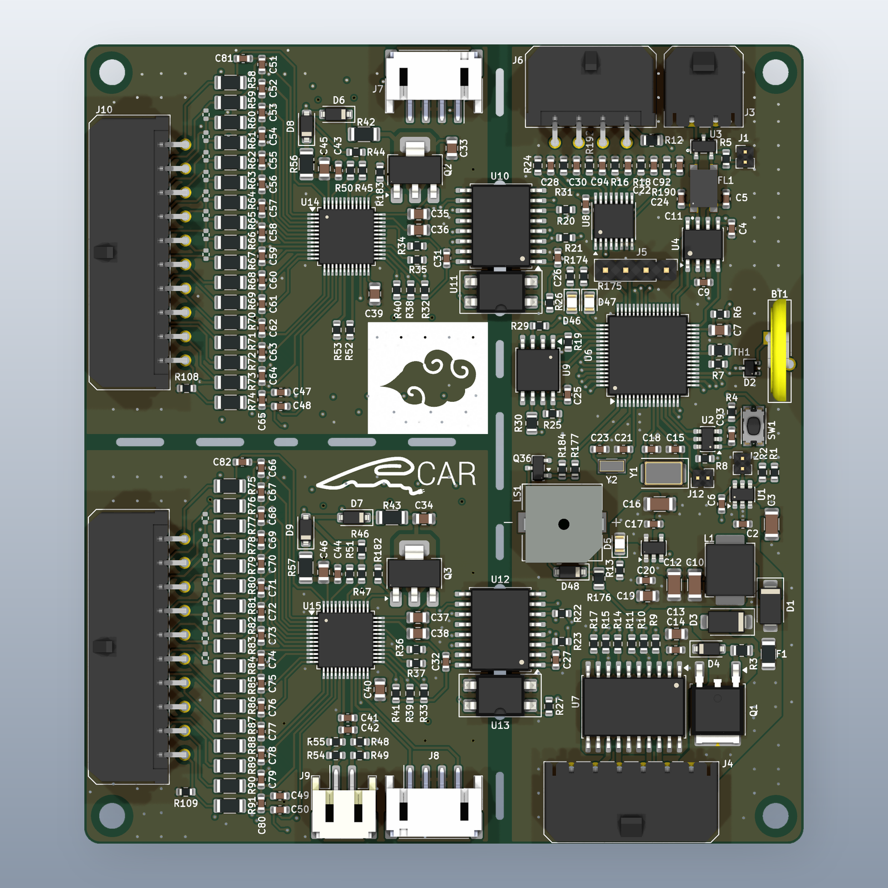
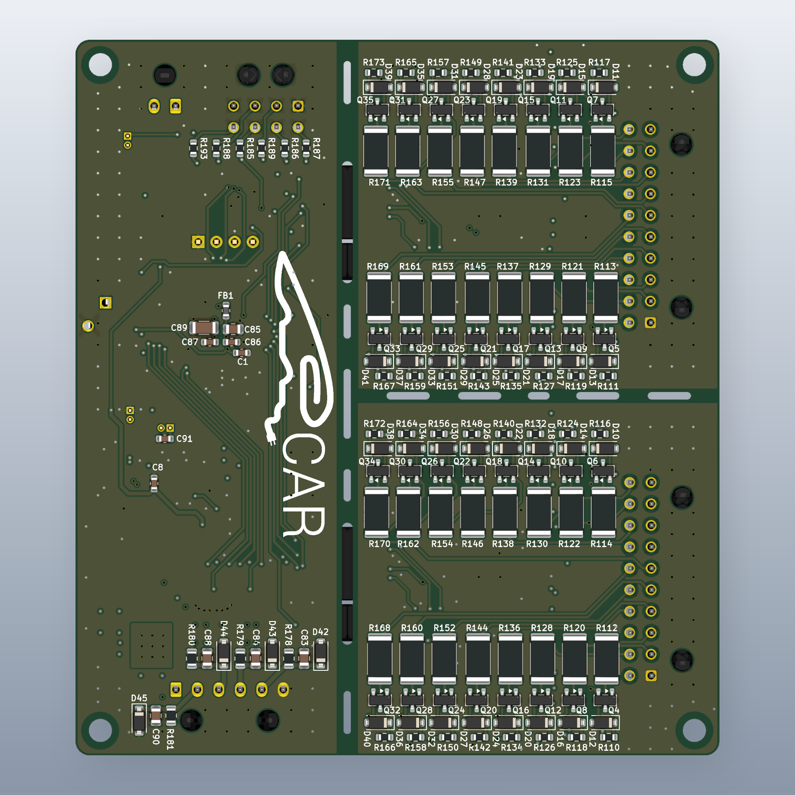
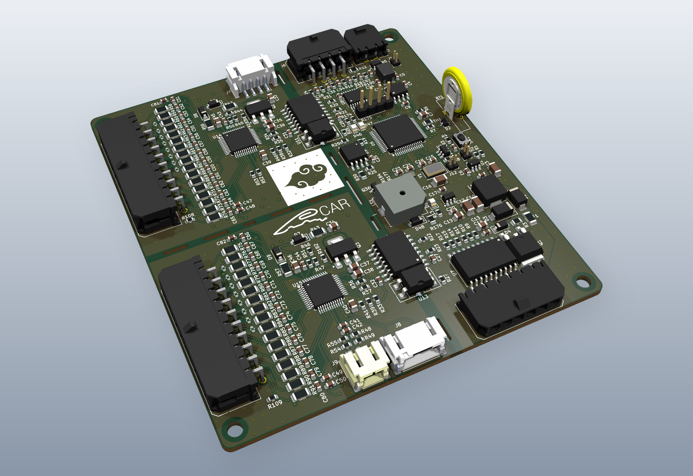

# 32S BMS

A battery management system board for **16S to 32S** packs, built around two
stacked **TI BQ76952** monitors and an **STM32G0B1** microcontroller. Designed in
KiCad 10.



| | |
|---|---|
| Cell count | 16S to 32S (2 × BQ76952, up to 16 cells each) |
| Balancing | 32 external MOSFET balancing channels |
| Supply | 12 V nominal (see [Power](#power)) |
| Interfaces | CAN, 4 high-side outputs, 6 configurable inputs |
| Board | 90 × 100 mm, 4 copper layers, 1.6 mm |
| Parts | 413 footprints |
| Revision | V0.1 |

## Features

### Cell monitoring and balancing
- Two BQ76952 monitors (`bq76952_TOP` / `bq76952_BOTTOM`) stacked to cover up to
  32 cells. The cell count is configurable between 16S and 32S.
- 32 external balancing channels (AO3416 MOSFETs with 2512 bleed resistors) with
  zener gate protection.
- Cell sense inputs on two Molex Micro-Fit 3.0 2×10 connectors.

### Isolation
- Each monitor has its own isolated link to the MCU. An ISO1644 carries I²C, ALERT
  and SHUT, and a PC817 optocoupler drives WAKE.

### Inputs
- 6 input channels on one connector, multiplexed through a 74HC4051 into a single
  MCU ADC channel.
- Each channel has a 4.7 kΩ series resistor, a 10 kΩ pull-down and a 100 nF filter
  capacitor. The connector also provides a 3.3 V pin through a 47 Ω resistor.
- Because of this structure, the same input can read either an analog or a digital
  signal:
  - **NTC thermistor** between the 3.3 V pin and the input forms a divider with
    the on-board resistors.
  - **Button or switch** to 3.3 V reads high when closed and is held low by the
    pull-down when open.
  - **Analog voltage** up to about 4.8 V full scale, set by the 4.7 k / 10 k
    divider.
- On-board NTC for board temperature.

### Always-on operation and sleep on command
- The BMS runs continuously and enters sleep mode only on command, for example
  from a CAN message.
- A TPL5010 nano-power timer acts as an external watchdog. The MCU acknowledges it
  periodically, and if the firmware hangs, the TPL5010 resets the MCU. The reset
  output reaches NRST through a jumper, so the watchdog can be disabled.
- In sleep mode, the MCU can put each BQ76952 into SHUTDOWN and the CAN transceiver
  into standby. Wake sources:
  - CAN bus activity
  - a push button, through the TPL5010 manual-reset input
  - a BQ76952 ALERT

### Communication and outputs
- CAN bus with a TJA1042T/3 transceiver, TDK ACT45B common-mode choke and
  PESD1CAN ESD protection. 120 Ω termination is selectable by jumper.
- 4 high-side switched outputs (Infineon BTS724G) at supply voltage, with
  flyback diodes and status feedback to the MCU.

### MCU and peripherals
- STM32G0B1RE with an external main crystal and a 32.768 kHz RTC crystal. The
  RTC is backed up by a CR1220 coin cell.
- W25Q32 SPI flash (32 Mbit) for data logging.
- SWD header, two status LEDs, a buzzer and a push button.

### Power
- 12 V input, protected by:
  - a fuse
  - an SS34 series diode for reverse polarity on the logic supply
  - an SMAJ15CA TVS diode
  - a P-MOSFET with zener-clamped gate for reverse polarity on the output stage
- A TPS54302 buck converter makes 5 V, and an AP2112K LDO makes 3.3 V.
- **Supply range:** 12 V nominal.
  - The upper limit is set by the SMAJ15CA TVS: 15 V standoff, about 16.7 V
    breakdown.
  - At the low end, the 5 V buck plus the series diode drop need roughly 6–7 V.
  - The TPS54302 itself accepts 4.5–28 V, so the input protection is what limits
    the range.

## Firmware

Firmware is under development and will be published in this repository as it
progresses.

## Gallery

| Top | Bottom |
|---|---|
|  |  |



## Repository layout

```
32s_bms/        KiCad project (schematic sheets: POWER, IN_OUT, MCU, bq76952)
32s_bms_lib/    Every non-standard part used by the design
  symbols/      Custom schematic symbols
  footprints/   Custom footprint libraries (.pretty)
  3dmodels/     STEP models for connectors and custom parts
32s_gerber/     Gerber and drill files (exported 2026-10-12)
32s_pdf/        Schematic PDF
docs/           Renders
```

## Opening the project

1. Install [KiCad 10](https://www.kicad.org/download/).
2. Clone the repository and open `32s_bms/32s_bms.kicad_pro`.

All custom symbols, footprints and 3D models are included, and the project
library tables use `${KIPRJMOD}`-relative paths. You don't need to configure any
libraries. Everything else comes from KiCad's standard libraries.

## Notes

- This is revision V0.1, shared as a design reference. Battery packs at this
  series count carry hazardous voltages. Review and test the design yourself
  before using it with real cells.
- Third-party 3D models (Molex, JST, TDK, Panasonic and others) are the property
  of their manufacturers and are included only so the 3D view renders correctly.

## License

The design files are released under the [MIT License](LICENSE). Third-party 3D
models in `32s_bms_lib/3dmodels/` are not covered by this license and remain under
their manufacturers' terms.

## Author

Tamer Gürelli
